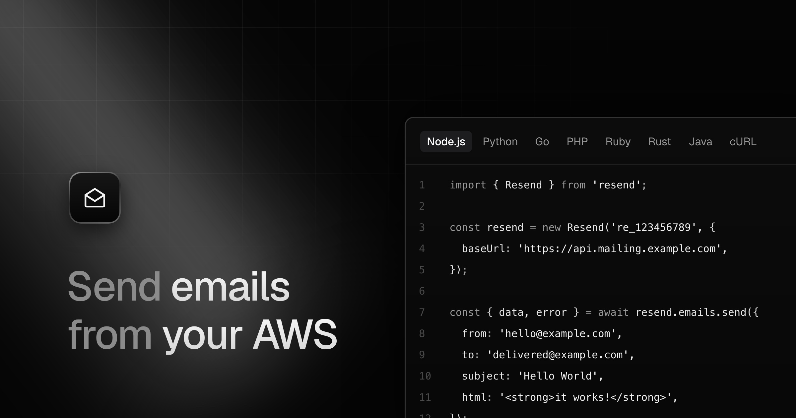

<p align="center">
  <a href="docs/deploying.md">Deploy an instance</a> ·
  <a href="docs/sending-email.md">Send email</a> ·
  <a href="docs/updating-instances.md">Stay up to date</a> ·
  <a href="docs/operations.md">Operations</a> ·
  <a href="docs/development.md">Development</a>
</p>

# opensender

A self-hosted email platform that speaks the [Resend](https://resend.com) API.
Deploy it into your own AWS account and point any official Resend SDK at it:
the only thing that changes in your app is the base URL.

- **Drop-in API.** Emails, batch, scheduling, idempotency, domains, API keys,
  contacts, segments, broadcasts, webhooks and inbound, matching Resend's wire
  format.
- **Runs on your AWS.** SES v2, Lambda, DynamoDB and CloudFront, deployed with
  [SST](https://sst.dev). No third-party email vendor, and your data stays in
  your account.
- **Multi-tenant.** Each team gets its own SES tenant, plan quotas, and
  reputation guardrails that freeze a team before it can hurt the account.
- **Dashboard included.** Domains, keys, emails, broadcasts, webhooks and team
  members, plus OAuth for connected apps and an MCP server for agents.
- **Cheap to run.** Serverless pay-per-use, native CloudWatch observability,
  budgets and a weekly cost report.

## Quickstart

```bash
git clone https://github.com/teovillanueva/opensender my-mailing
cd my-mailing
# edit instance.config.ts: domain, region, alert email, plans
pnpm install
pnpm exec sst deploy --stage production
```

The full walkthrough, including DNS, secrets and the first admin user, is in
[Deploying an instance](docs/deploying.md).

## Send your first email

Use the official Resend SDK and set the base URL to your instance's API:

```ts
import { Resend } from "resend";

const resend = new Resend("re_123456789", {
  baseUrl: "https://api.mailing.example.com",
});

const { data, error } = await resend.emails.send({
  from: "hello@example.com",
  to: "delivered@example.com",
  subject: "Hello World",
  html: "<strong>it works!</strong>",
});
```

Or with plain HTTP:

```bash
curl -X POST https://api.mailing.example.com/emails \
  -H "Authorization: Bearer re_123456789" \
  -H "Content-Type: application/json" \
  -d '{
    "from": "hello@example.com",
    "to": "delivered@example.com",
    "subject": "Hello World",
    "html": "<strong>it works!</strong>"
  }'
```

More in [Sending email](docs/sending-email.md).

## Documentation

| Guide | What's in it |
| --- | --- |
| [Deploying an instance](docs/deploying.md) | Prerequisites, configuration, DNS, secrets, first admin, one-time AWS setup |
| [Sending email](docs/sending-email.md) | SDKs, base URL, API keys, request limits |
| [Keeping an instance up to date](docs/updating-instances.md) | Private instance repos, hourly upstream sync, SST Console Autodeploy |
| [Operations](docs/operations.md) | Observability, SES limits, secret rotation, DLQs, paused tenants, costs |
| [Development](docs/development.md) | Repo layout, checks, local dev, acceptance suite |
| [Glossary](docs/glossary.md) | Instance, Team, Tenant, Plan and the rest of the domain language |
| [Architecture decisions](docs/adr) | ADRs |
| [Specification](SPEC.md) | The full product and engineering spec |

## License

[MIT](LICENSE)
